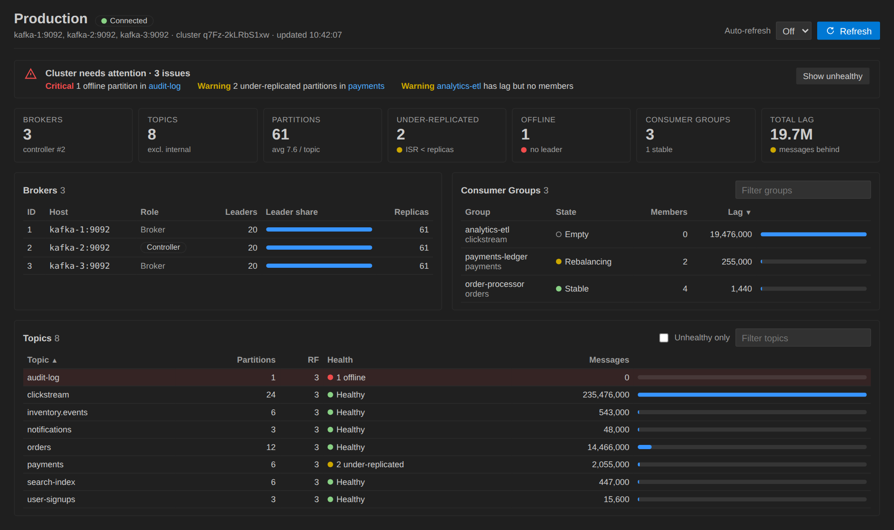
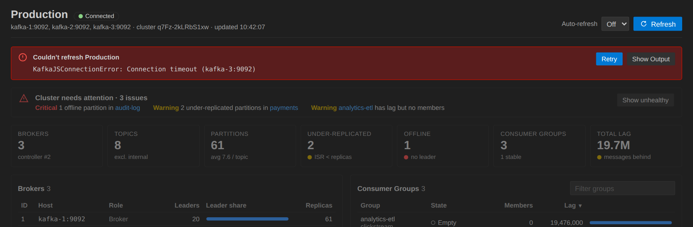
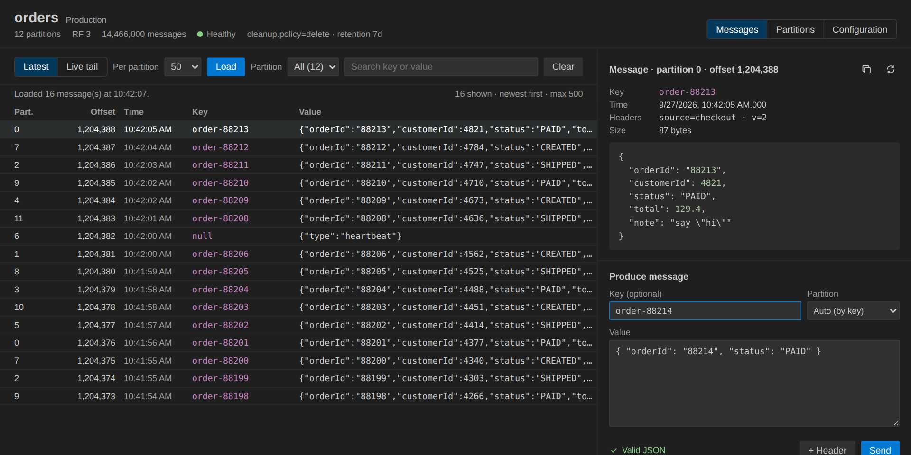
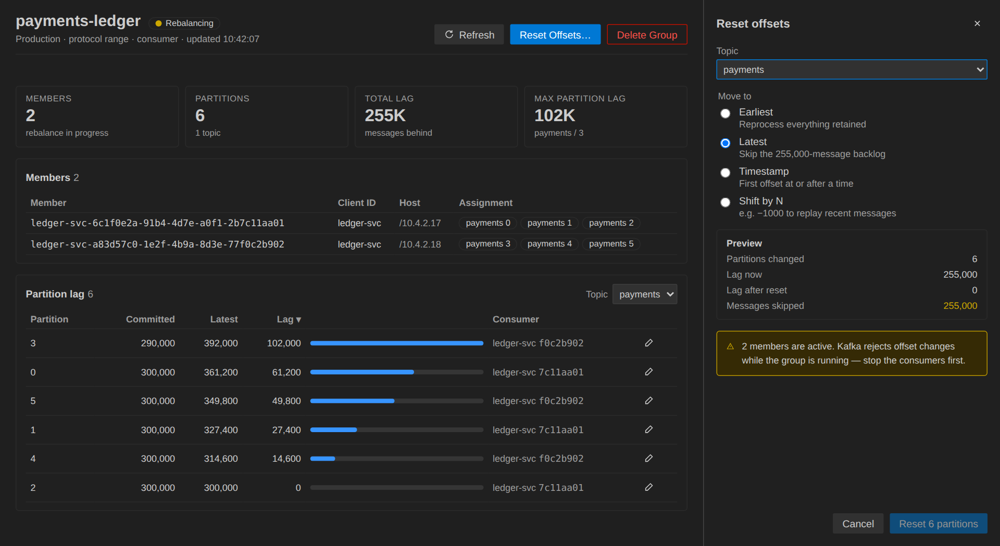
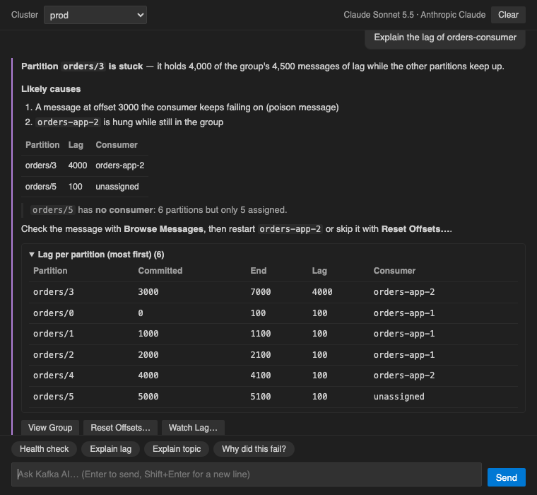

# vscode-kafka

Manage Apache Kafka clusters directly from VS Code: connect to one or more clusters, browse topics and partitions, inspect consumer groups and their lag, produce messages, and tail live traffic — all from a sidebar tree and a message-browser panel.



## Features

- **Cluster dashboard** — click the dashboard icon on a connected cluster (or run **Kafka: Open Cluster Dashboard**, or click the Kafka item in the status bar) for a one-page health view: an issues banner with links to the affected topics and groups, broker/topic/partition/group counts, under-replicated and offline partitions, total consumer lag, per-broker leader distribution, and sortable, filterable topic and consumer-group tables. Optional auto-refresh every 10/30/60 seconds; if refreshes keep failing, the last good data stays on screen, marked stale.
- **Cluster explorer** — a "Kafka" activity bar view lists your configured clusters with their connection state. Topics show a green/yellow/red health dot with details on hover. The cluster context menu can open the dashboard, create a topic, copy the bootstrap servers, set a Schema Registry, show ACLs, rename or remove the cluster.
- **Guided setup** — a welcome view on first run, and a two-step **Add Cluster** input that checks every broker is `host:port` and connects right away.
- **Topic panel** — click a topic for three tabs. **Messages**: read from the newest or oldest offset, a specific offset or a point in time, on all partitions or one; page with **Load older** / **Load newer**; or live-tail new ones (with pause). Filter what's loaded, or **Search topic** to scan up to 100k messages per partition for text in the key, value or headers (with progress and Cancel). Inspect a message's key, headers, pretty-printed JSON, schema and size; copy it, load it into the produce form, or **copy as a kcat command**. **Export…** saves what's shown as JSON or NDJSON. **Partitions**: leader, replicas, ISR, health and offsets per partition, and **Add partitions…**. **Configuration**: edit settings inline (with a confirmation diff before saving) or reset them to the default.
- **Schema Registry decoding** — set a Schema Registry on a cluster (**Configure Schema Registry…**) and Avro, Protobuf and JSON Schema payloads in the Confluent wire format are decoded automatically, showing the schema id and subject. Key and value format pickers also offer String, JSON, Hex and Base64. Produce can encode a JSON value with a subject's latest schema.
- **Produce** — send a message with an optional key, target partition and headers; JSON values are checked as you type (Ctrl/Cmd+Enter sends). Use `{{uuid}}`, `{{now}}`, `{{nowMs}}`, `{{random.int}}` and `{{seq}}` in the key, value and headers; send ×N with an optional delay for quick load tests; save the form as a **template** per topic. **From file…** sends every record of a JSON array or NDJSON file (exports can be replayed as-is) with a progress bar.
- **Lag alerts** — **Watch Lag…** on a consumer group (or in its panel) sets a threshold. While the cluster is connected its lag is checked in the background (`kafka.lagAlertIntervalSeconds`); you get one notification when it crosses the threshold and a status bar warning until it recovers.
- **Dev mode (auto-detect issues)** — run **Kafka: Toggle Dev Mode** (or set `kafka.devMode.enabled`) and every connected cluster is scanned in the background for common problems: no controller, offline or under-replicated partitions, consumer groups with lag but no running consumers, committed offsets already deleted by retention or past the end of a recreated topic, offsets left for deleted topics, rebalances that don't finish, lag that keeps growing, messages landing in dead-letter topics (`.dlq`, `-dlt`, `ordersDLT`…) and near-identical topic names that are usually typos. New issues are logged to the Kafka Manager output and notified; the status bar shows the count, and **Kafka: Show Detected Issues** lists them with what they usually mean — pick one to open its topic or group. No AI is involved; **Diagnose with AI** is offered when AI is set up.
- **Brokers and ACLs** — the **Brokers** node lists each broker with its leader/replica counts; click one (or a broker row on the dashboard) for its settings and their source. **ACLs** shows a read-only list filterable by principal, resource and type.
- **Consumer group panel** — state, members with their assigned partitions, and lag per partition (counting only retained messages when nothing is committed, and never negative). **Reset Offsets…** moves a topic to earliest, latest, a timestamp, or shifts by N, with a preview of partitions changed and messages skipped or replayed; it's blocked while the group has active members.
- **Topic management** — create and delete topics from the tree's context menu.
- **Kafka AI** — ask about your clusters in plain language with **Claude, GPT, Gemini**, OpenRouter, Mistral, Groq, DeepSeek, xAI, Azure OpenAI, a local **Ollama** / LM Studio model, or GitHub Copilot. Explain connection failures, lag alerts, topic and broker configs, messages and decode errors; infer a schema; get a dashboard health summary. Read-only, and secrets never leave VS Code. See [AI assistance](#ai-assistance).

## Screenshots

### Cluster dashboard

Health at a glance: open issues with links to the affected topics and groups, summary tiles, broker leadership, consumer-group lag and topic sizes.


When a refresh fails, the last good data stays on screen, marked stale, with Retry and Show Output.



### Topic panel

Browse the newest messages or live-tail new ones, inspect a message's key, headers and JSON value, and produce messages with a key, partition and headers.



### Consumer group panel

Members and their assigned partitions, lag per partition, and a Reset Offsets panel that previews the change before applying it.



## AI assistance



Kafka Manager can explain what it reads from your cluster using an AI model **you** choose. It doesn't depend on GitHub Copilot: bring your own API key, sign in with OpenRouter, run a model locally, or use the chat models you already have in VS Code.

### Set up a provider

Run **Kafka: AI Setup…** (the ✨ icon on the Kafka view) and pick a provider:

| Provider | How you sign in | Notes |
| --- | --- | --- |
| **Anthropic Claude** | API key ([console.anthropic.com](https://console.anthropic.com/settings/keys)) | Recommended model: the latest Sonnet |
| **OpenAI GPT** | API key ([platform.openai.com](https://platform.openai.com/api-keys)) | |
| **Google Gemini** | API key ([aistudio.google.com](https://aistudio.google.com/apikey)) | Has a free tier |
| **OpenRouter** | **Sign in with your browser** (OAuth), or an API key | One account for Claude, GPT, Gemini, Llama, Mistral… |
| **VS Code language models** | Handled by VS Code (e.g. GitHub Copilot) | Any installed chat model extension |
| **Ollama** / **LM Studio** | Nothing: runs on this machine | Data never leaves your computer |
| Azure OpenAI, Mistral, xAI Grok, DeepSeek, Groq | API key | Azure needs your endpoint URL |
| Custom OpenAI-compatible | Optional key + endpoint URL | LiteLLM, vLLM, a company gateway… |

- **API keys** are stored in VS Code's secret storage (your OS keychain), never in settings files. Kafka Manager checks a key against the provider before saving it. Keys in the usual environment variables (`ANTHROPIC_API_KEY`, `OPENAI_API_KEY`, `GEMINI_API_KEY`, `OPENROUTER_API_KEY`…) are picked up too. **Kafka: Remove AI API Key…** deletes one.
- **OpenRouter sign-in** opens openrouter.ai in your browser; approve Kafka Manager there and a key is created and stored for you (OAuth PKCE with a one-time `localhost` callback, or a code to paste in remote setups).
- **Models** are listed live from the provider, so new models show up without an update. Leave the model on *Recommended* to follow the provider's current mid-range model, or pin one with **Kafka: Select AI Model…**.
- With `kafka.ai.provider` on **Auto** (the default), Kafka Manager uses the first provider you've added a key for, else VS Code's chat models.

### What it does

- **Kafka AI panel**: **Ask AI** on the Kafka view, a cluster, the dashboard or a consumer group opens a chat for that cluster, with quick actions (*Health check*, *Explain lag*, *Explain topic*, *Why did this fail?*), the data it used as tables next to the answer, and buttons for the follow-up action (View Group, Reset Offsets…, Edit Connection Security…). For free-form questions the model can look things up itself with the read-only Kafka tools below.
- **`@kafka` in the Chat view** with `/diagnose`, `/lag`, `/explain-error` and `/topic`. Set `kafka.ai.chatLocation` to `chatView` to make **Ask AI** open there instead of the panel.
- **Explain with AI** on a connection failure, and **Ask AI: Why Did This Fail?** on a cluster in the error state.
- **Lag alerts**: Kafka Manager keeps the last 30 readings of each watched group (in memory) and spots a stuck partition, consumers that are down, a rebalance, a producer burst or consumers falling behind — without any AI. The alert says what it found; **Analyze** asks the model for the cause and next steps. `kafka.ai.autoAnalyzeLagAlerts` adds a one-line AI cause to the notification itself.
- **Dashboard**: an **AI summary** card with the top risks (only when you click it; cached while the dashboard is open).
- **Topic panel**: **Explain config** (with Kafka Manager's own checks for risky settings such as `min.insync.replicas` ≥ replication factor, replication factor 1, unbounded retention, compaction without keys and leader skew), and ✨ on a message to explain it or why it couldn't be decoded. **Infer schema** proposes a JSON Schema, an Avro schema and a produce template from the loaded messages.
- **Broker panel**: **Explain config**.
- **Tools for agent mode**: `#kafka_listClusters`, `#kafka_clusterOverview`, `#kafka_listTopics`, `#kafka_describeTopic`, `#kafka_listConsumerGroups`, `#kafka_describeConsumerGroup`, `#kafka_describeBroker`, `#kafka_listAcls`, `#kafka_connectionError` and `#kafka_peekMessages`, usable by Copilot agent mode or any tool-calling chat in VS Code.

### Privacy: what leaves your machine

The first time you use AI with a provider, Kafka Manager shows exactly what is sent and where, and asks you to confirm. Switching to another provider asks again.

- **Sent**: cluster, topic, consumer group and broker names; partition, offset and lag figures; configs; error messages; and your question.
- **Never sent**: passwords, SASL usernames, Schema Registry credentials, API keys, AWS keys, certificate and key file paths, and `sasl.jaas.config` values. These are stripped from everything, including tool results and message contents.
- **Message keys, headers and values** are only sent if you turn on `kafka.ai.includeMessagePayloads` (Kafka Manager asks the first time you use Explain message or Infer schema), and are truncated.
- **Hostnames** of brokers and the Schema Registry are replaced with `host-1`, `host-2`… with `kafka.ai.maskHosts`.
- **Local models** (Ollama, LM Studio) keep everything on your computer.
- **The AI never changes your cluster.** Every tool is read-only; actions are buttons you click yourself.
- AI is off in untrusted workspaces, and `kafka.ai.provider` / `kafka.ai.baseUrl` can only be set in user settings, so a repository can't redirect your API key. Turn every AI feature off with `kafka.ai.enabled`.

## Requirements

Network access to your Kafka broker(s). No local Kafka installation is required by the extension itself — it talks to brokers over the wire via [KafkaJS](https://kafka.js.org/).

## Getting started

1. Open the Kafka view in the activity bar.
2. Click **Add Cluster** (`+`), enter a name and comma-separated broker list, e.g. `localhost:9092`, then choose how the cluster authenticates (a choice is suggested from the port/host).
3. The cluster connects straight away; use the connect icon to reconnect later.
4. Click the dashboard icon for a health overview, expand **Topics** or **Consumer Groups** to browse, or click a topic to open its panel.

## Connecting to secured and remote clusters

| Cluster | Choose |
|---|---|
| Local / Docker (`PLAINTEXT`) | No authentication, Plaintext |
| Self-signed TLS dev cluster | No authentication, TLS, *Don't verify* or a CA file |
| Amazon MSK, port 9094 | No authentication, TLS |
| Amazon MSK, port 9096 | SASL/SCRAM-SHA-512, TLS |
| Amazon MSK, port 9098 | AWS IAM (uses your AWS credential chain or a named profile; run `aws sso login` first if you use SSO) |
| Confluent Cloud | SASL/PLAIN, TLS — the API key is the username, the secret the password |
| Aiven (client certificate auth) | No authentication, TLS, CA file `ca.pem`, client certificate `service.cert` + key `service.key` |

Change these later with **Edit Connection Security…** on the cluster's context menu. Passwords are kept in VS Code's secret storage, never in `settings.json`; if a cluster has SASL configured but no saved password (for example after Settings Sync to a new machine) you're asked for it on connect.

When a connection fails, the error includes a hint about the likely cause. Common ones:

- **Docker: `getaddrinfo ENOTFOUND kafka` (or another container name).** The bootstrap server answered but advertises an address VS Code can't reach. Set `KAFKA_ADVERTISED_LISTENERS` to an address reachable from your machine (e.g. `PLAINTEXT://localhost:9092`, with a separate internal listener for other containers).
- **Docker: connection refused on localhost.** The container isn't running or the port isn't published (`-p 9092:9092`). From inside a dev container, use `host.docker.internal` instead of `localhost`.
- **Amazon MSK: timeout or host not found.** MSK brokers are private to their VPC by default. Connect over VPN or an SSH tunnel, or enable public access (ports 9194/9196/9198) and allow your IP in the security group.

## Sharing clusters with a team

**Add Cluster** asks whether to save the cluster in your **user** settings or the **workspace** settings (`.vscode/settings.json`), which you can commit so everyone who opens the repository gets the same cluster list. The cluster's tooltip shows where it's saved. Passwords are never written to either file: each person is asked for theirs on first connect, and it's kept in their own secret storage. Workspace clusters are only used once you trust the workspace.

## Extension Settings

* `kafka.clusters`: array of `{ id, name, brokers, ssl?, sasl?, schemaRegistry? }` entries, in user or workspace settings. Normally managed via the **Kafka: Add Cluster** / **Edit Connection Security…** / **Configure Schema Registry…** / **Remove Cluster** commands, but can be hand-edited in `settings.json` — changes take effect immediately: the tree updates, a connected cluster reconnects when its brokers or security change, and open panels follow renames and close when their cluster is removed. Example:

  ```json
  {
    "id": "…",
    "name": "MSK prod",
    "brokers": ["b-1.prod.abc123.c2.kafka.us-east-1.amazonaws.com:9098"],
    "sasl": { "mechanism": "aws-iam", "region": "us-east-1", "profile": "prod" }
  }
  ```

  `ssl` is `true`, or an object with any of `caFile` (private CA), `certFile` + `keyFile` (client certificate for mutual TLS; the key must not be passphrase-protected) and `rejectUnauthorized: false` (dev only). `sasl.mechanism` is one of `plain`, `scram-sha-256`, `scram-sha-512` (with `username`) or `aws-iam` (with `region` and optional `profile`). `schemaRegistry` is `{ "url": "http://localhost:8081", "username"?: "…" }`.
* `kafka.lagAlerts`: array of `{ cluster, group, threshold }` (cluster id or name). Managed with **Watch Lag…** / **Stop Watching Lag** on a consumer group.
* `kafka.lagAlertIntervalSeconds`: how often watched groups are checked (default 60, minimum 10).
* `kafka.ai.enabled`: turn every AI feature on or off (default on; always off in untrusted workspaces).
* `kafka.ai.provider`: `auto` (default), `anthropic`, `openai`, `gemini`, `openrouter`, `vscode`, `azureOpenai`, `mistral`, `xai`, `deepseek`, `groq`, `ollama`, `lmstudio` or `custom`. User settings only.
* `kafka.ai.model`: model id for the provider (e.g. `claude-sonnet-5-5`, `gpt-5.5`, `gemini-flash-latest`, `llama3.2`); empty for the provider's recommended model.
* `kafka.ai.baseUrl`: endpoint override (required for Azure OpenAI and custom servers). `https://`, or `http://` to localhost only. User settings only.
* `kafka.ai.maxOutputTokens`: longest answer requested from API-key providers (default 2048).
* `kafka.ai.includeMessagePayloads`: send message keys, headers and values, truncated (default off).
* `kafka.ai.maskHosts`: replace broker and Schema Registry hostnames with placeholders (default off).
* `kafka.ai.chatLocation`: where **Ask AI** opens: `panel` (default) or `chatView` (`@kafka`).
* `kafka.ai.autoAnalyzeLagAlerts`: add a one-line AI cause to lag alert notifications (default off).
* `kafka.devMode.enabled`: scan connected clusters for common issues in the background (default off).
* `kafka.devMode.scanIntervalSeconds`: how often dev mode scans, in seconds (default 30, minimum 10).
* `kafka.devMode.notify`: notify about new warning and critical issues (default on).
* `kafka.devMode.ignoredRules`: dev mode checks to skip, e.g. `["similarTopicNames"]`.

## Known Issues

- SASL/GSSAPI (Kerberos), generic SASL/OAUTHBEARER and passphrase-protected client keys are not supported yet.
- The message browser and live tail read through a short-lived consumer group that never commits offsets and is deleted afterwards, so real consumer groups are never affected. These `vscode-kafka-*` groups are hidden from the tree and dashboard, including any left by versions before 0.3.0.
- Broker log directory sizes aren't shown: KafkaJS has no DescribeLogDirs API.
- Resetting offsets takes a few seconds per topic, because KafkaJS commits them through a short-lived consumer.

## Release Notes

See [CHANGELOG.md](CHANGELOG.md) for the full history.

### 0.4.0

- **Kafka AI** with the provider you choose: Claude, GPT, Gemini, OpenRouter (browser sign-in), Mistral, Groq, DeepSeek, xAI, Azure OpenAI, Ollama, LM Studio, any OpenAI-compatible endpoint, or VS Code's models such as GitHub Copilot. Keys live in your OS keychain.
- A **Kafka AI chat panel**, **`@kafka`** in the Chat view, and read-only **`#kafka_*` tools** the model uses to investigate by itself.
- **Explain with AI** for connection failures, lag alerts (with rule-based trend analysis), topic and broker configs (with risky-setting checks), messages and decode errors; **Infer schema**; a dashboard **AI summary**.
- Privacy by default: secrets are never sent, message contents only with opt-in, hostnames can be masked, nothing ever changes your cluster.

### 0.3.0

- **Browse anywhere in a topic** — start from the newest or oldest message, an offset or a point in time; page older/newer; search a topic's keys, values and headers.
- **Schema Registry** — Avro, Protobuf and JSON Schema values are decoded (with schema id and subject), format pickers for keys and values, and produce can encode with a subject's schema.
- **Produce** — templates with `{{uuid}}`/`{{now}}`/`{{seq}}` variables, send ×N, send a batch from a JSON/NDJSON file; export messages; copy as a kcat command.
- **Topics** — edit settings inline, reset to default, add partitions, set retention and cleanup policy on create.
- **Lag alerts**, **broker details**, a read-only **ACL list**, mutual TLS, and clusters shared through workspace settings.
- **Fixes** — the message browser and tail no longer leave consumer groups behind; lag no longer overstated or negative; panels follow disconnect/remove/rename and a disconnect stops the live tail; hand edits to settings apply immediately; Create Topic no longer fails right after creating the topic.

### 0.2.0

- **New: Secured clusters** — TLS (system CAs, custom CA file, or unverified for dev), SASL/PLAIN, SASL/SCRAM-SHA-256/512 and Amazon MSK IAM. Add Cluster suggests settings from the port/host; change them later with **Edit Connection Security…**. Passwords live in VS Code's secret storage.
- **Connection hints** — failures explain the likely cause and fix: wrong auth/TLS mode, untrusted certificate, Docker `advertised.listeners` or unpublished port, MSK VPC reachability, missing AWS credentials.
- **Lost connections are detected** — the cluster moves to an error state with a Reconnect action instead of staying "connected".
- **Fixes** — refused connections showing no reason, and hand edits to `kafka.clusters` needing a reload.

### 0.1.0

- **New: Cluster dashboard** — health tiles, an issues banner, broker leader distribution, topic sizes and consumer-group lag in one panel, with filtering, sorting, auto-refresh, and click-through to topic and group panels. Failed refreshes keep the last good data on screen, marked stale.
- **New: Status bar item** showing connected clusters and open issues.
- **Explorer** — welcome view, topic health dots and tooltips, last connection error on the cluster, and Copy Bootstrap Servers, Rename and Create Topic in the cluster menu. Add Cluster now validates `host:port` and connects immediately.
- **Topic panel redesign** — Messages / Partitions / Configuration tabs, live tail with pause, partition filter and search, message detail with headers and highlighted JSON, and produce with partition and headers.
- **Consumer group panel redesign** — members with assignments, per-partition lag, and Reset Offsets (earliest, latest, timestamp, shift by N) with a preview.
- **Fixes** — Rename Cluster always failing, Create Topic reporting success for an existing topic, the admin client left open after a failed connection, and consumer group offsets not refreshing.

### 0.0.4

- CI/CD: tests on Linux, Windows and macOS, `.vsix` packaging, and Marketplace publishing on `v*` tags.
- Fixed the test build and the cluster name not updating after a rename.

### 0.0.1

Initial release: cluster explorer, topic/partition browsing, consumer group lag, message tailing and producing, topic create/delete.
